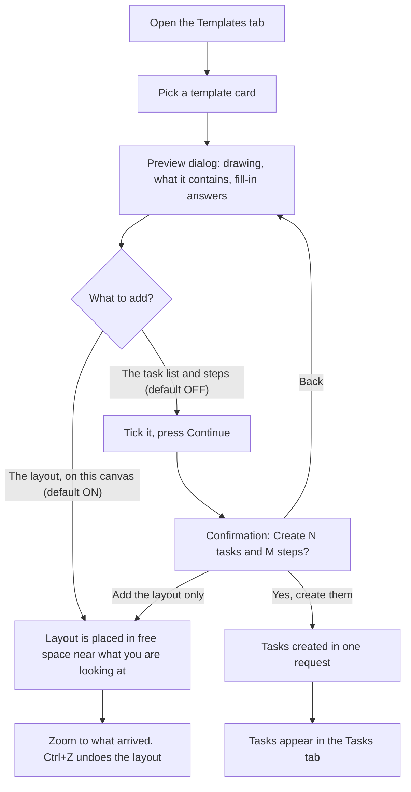
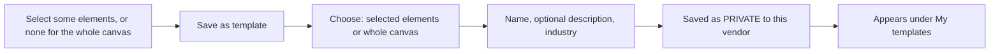

# Workspace Templates: how they work

A single reference for the **Templates** feature in the vendor workspace: what a template is, how a vendor uses one, how progress is tied to tasks, and how the pieces fit together.

> **Status (read first).** Everything described here is built and covered by automated tests (frontend 675, backend 85 passing). It was checked in a test page that imitates the workspace, **not yet in the running app**. The one thing that depends on the live app is called out in [section 9](#9-verification-status). Community sharing of templates is **not built** (see [section 11](#11-not-built-yet)).

---

## 1. The short answers

**Does ticking a checklist update the progress card on the main workspace canvas, or must the vendor submit through "Update Progress"?**

**Ticking updates it automatically. Nothing needs to be submitted.** The progress bars and status badges on a template's overview canvas that are *linked to tasks* are worked out from the ticked items on the checklist cards inside the tasks. The vendor ticks, and the bar and badge change.

**"Update Progress" (the blue button in the header) is a separate thing.** It is a *written report* (title, work done, work pending, date, proof of completion) saved for the PM and client to review. It does not read the checklists and it does not change any progress bar. The two are **not connected**. See [section 7](#7-progress-blocks-vs-the-update-progress-button).

**Is the progress tied to a task or a subtask?** To a **task** (a phase) or to the **whole project**, never to a single subtask. A linked block adds up the ticked items across *all the steps (subtasks)* inside the task it points at.

| Term in the product | What it is in a template |
|---|---|
| **Task** | A phase of the project (e.g. "Excavation & foundation") |
| **Subtask** | A step inside a phase (e.g. "Excavation", "PCC & footing"). Each step has its **own canvas** |
| **Checklist card** | A Task Card element on a canvas. Its ticked / total items are what progress is counted from |
| **Overview canvas** | The main canvas that shows the whole plan: the diagram, status badges, progress bar, countdown, plus a checklist card and a table |

---

## 2. Where templates are in the product

The left dock now has two separate tabs:

| Tab | Purpose |
|---|---|
| **Tools** (wrench icon) | What used to be called "Templates": shortcuts that open a form or screen (Quotations/Invoices, Payments, BOQ, Cost Calculators, RFQ form, Work Order, RFI, Inspection, Daily Site Log). These are **not** templates; they open tools. Unchanged apart from the name. |
| **Templates** (layout icon) | The new template gallery. Two lists: **Official** (everyone) and **My templates** (vendors only). |

Also reachable from: the Ctrl+K palette ("Browse Templates"), and the "Start from a template" card on an empty canvas.

Untouched on purpose: the BOQ templates and the flowchart templates in the Elements panel (SWOT, Business Model Canvas, etc.) still work exactly as before.

---

## 3. What a template contains

A template has **three layers**. A vendor can add the first on its own, the second on its own, or both.

```
Template
├── 1. Overview layout            (goes on the canvas that is open)
│     ├── diagram: the stages as boxes joined by arrows
│     ├── status badges, progress bar, KPI card, countdown
│     ├── a real checklist card     ← working element
│     └── a real, editable table    ← working element
│
├── 2. Task list                  (created in the workspace's Tasks, optional, asks first)
│     └── Task (phase), with a due date
│           └── Subtask (step), each with its OWN canvas holding:
│                 ├── a checklist card
│                 └── sometimes an editable table
│
└── 3. Fill-in answers            (asked in the dialog, all optional)
      project name · client · site · start date
```

### Working with the tables

The tables on a template are real, editable tables:

- **Double-click a cell** to type in it. **Enter** or clicking away saves it; **Esc** puts the old text back.
- **Add row** adds a blank row and puts the cursor in its first cell. The bin icon on a row deletes it.
- Edits are saved with the canvas and shown to everyone on it. While the element is under approval it is locked and the table says so.

### The fill-in answers

Typed in the dialog and placed wherever the template has a `{{placeholder}}`:

| Answer | Used for |
|---|---|
| Project name | Heading, e.g. "Sharma Villa: civil works plan" |
| Client, Site | A small line under the heading, e.g. "Client: Mr. Sharma · Site: Baner, Pune" |
| Start date | The reference for every due date and for the countdown |

Leaving an answer blank never leaves a stray label behind. "Client: · Site:" becomes nothing; a heading with no project name simply reads "Civil works plan".

### Dates

- Each task gets a due date: **start date + its offset + its duration**.
- A countdown block counts down to the end of the last phase (for example 135 days for the Civil Works plan).
- No start date entered means "today".

---

## 4. The flow: how a vendor uses a template

### 4.1 Adding a template to a workspace that already has a canvas



The two choices are independent:

| Layout ticked | Tasks ticked | Result |
|---|---|---|
| yes | no | Only the layout is added to the open canvas. **Nothing is created in Tasks.** (default) |
| yes | yes | Layout added **and** tasks created (after the confirmation). |
| no | yes | **Only** the tasks are created. No second copy of the diagram. Use this to add tasks later. |
| no | no | The button is disabled: "Choose what to add". |

**Tasks are never created without asking.** The task option starts unticked, and ticking it then shows a confirmation that says how many tasks and steps will be created and that everyone with access to the workspace will see them.

### 4.2 A workspace with no tasks yet

A workspace with no tasks has no canvas at all, because every canvas belongs to a task's step. The screen shows one thing: **Create First Task**.

If the vendor uses a template from the Templates tab anyway:

- The layout option is not offered (there is nowhere to put it).
- The task list is the only choice, ticked and locked, with a note: *"This workspace has no canvas yet, so the layout becomes the first task, 'Overview'."*
- On confirming, the workspace gets an extra first task, **"<Project> overview"**, with one step, **"Overview"**, whose canvas holds the whole layout. The tasks follow. The Overview canvas opens straight away.

### 4.3 Where the created tasks appear

- **Tasks tab** in the left dock: the phases.
- Open a task: its steps. Open a step: **its own canvas** with a checklist card (and sometimes a table) already on it, ready to tick and fill in.
- The steps are **independent**: none waits for another. They are listed in order (step 1, 2, 3 …), but a step only depends on another if someone sets that up in the step's own settings. This is the same default as adding a subtask by hand.

### 4.4 Saving your own template

Vendors only. In **Templates → My templates → "Save this canvas as a template"**:



- The saved template holds **the canvas layout only**: elements, positions and connections. It does **not** hold tasks.
- Using one of your own templates works like the layout option above. There is no task list to create.
- You can **edit the details** (name, description, industry) and **delete** a template (asks to confirm).

**What is left out when saving**, enforced by the server, not just the screen:

| Left out | Why |
|---|---|
| Workspace and task ids, task and step names | Ties the layout to one project |
| Who added what, and when | Personal |
| Comments | Private conversations |
| Approval state | Reset to "pending" when reused |
| Uploaded files and image links | Files belong to the original workspace |
| Anything that looks like an email, phone, token, password, GSTIN, account number | Contact and credential data |
| Quotations, invoices, credit notes, purchase orders, turnkey and AI helper elements | They carry customer and financial records |
| Embedded images stored as `data:` text | Size and privacy |

---

## 5. The official templates

Nine templates, shipped with the app. Every one has the overview layout and a task list.

| Template | Industry | Tasks → steps | Duration | Main-canvas working elements | Status / progress blocks linked to tasks |
|---|---|---|---|---|---|
| Civil Works Project Plan | Construction | 6 → 13 | 135 days | Checklist "Before work starts", table "Milestones" | Overall progress (project); Site mobilisation, Foundation, Structure |
| Site Daily Progress Board | Construction | 2 → 2 | 7 days | Checklist "Today's checklist", table "Labour attendance" | none (numbers typed) |
| Snag & Handover Checklist | Construction | 3 → 4 | 22 days | Checklist "Walk-through checklist", table "Snag log" | Snags closed (task: Snag closure) |
| Interior Fit-Out Plan | Interiors | 6 → 11 | 75 days | Checklist "Watch-outs", table "Material schedule" | Overall progress (project); Design, Materials, Site works |
| Procurement Cycle (PR → PO → GRN) | Manufacturing | 3 → 5 | 24 days | Checklist "Purchase order checklist", table "Quote comparison" | none |
| Production Line Setup | Manufacturing | 4 → 8 | 75 days | Checklist "Go-live checklist", table "Machine tracker" | Setup progress (project); Machines, Operators trained, Safety audit |
| QC Inspection Flow | Manufacturing | 1 → 2 | 1 day | Checklist "Inspection checklist", table "NCR log" | none |
| Retail Store Launch Plan | Retail | 5 → 8 | 90 days | Checklist "Pre-launch checklist", table "Vendors" | Launch readiness (project); Licences, POS & billing, Marketing |
| Monthly Sales Review | Retail | 2 → 2 | 4 days | Checklist "Review checklist", table "Action log" | none |

The blocks that are **not** linked can be linked by hand: select the block, then **Take it from your tasks** in its settings.

The wording of the stages and checklists is a general starting point. It should be reviewed by someone who knows the trade before the templates are promoted to customers.

---

## 6. How progress is tied to tasks

### 6.1 The rule

A **status badge** or **progress bar** can be *linked*. Its link is one of:

| Link | Meaning |
|---|---|
| **Whole project** | Count every checklist item in every task of this workspace |
| **A task** (by name) | Count every checklist item in every step (subtask) of that task |
| *(none)* | The old behaviour: the vendor types the value |

The count is:

```
progress % = ticked checklist items ÷ all checklist items     (in the linked scope)
```

- Only **Task Card** elements are counted (the checklist cards). A card with **no** checklist counts as one item, done when its status is "Completed".
- The task is found **by name** (case and spacing ignored). A phase created from a template keeps its name, so the template's blocks find their own phases. If two tasks share a name, the first is used.
- If the task is renamed or deleted, the block shows **"Task not found"** and keeps its typed-in value, so it never shows a wrong number.
- If the linked task has no checklist items yet, the block shows **"From <task>: nothing to tick yet"** and keeps its typed-in value.

### 6.2 What the status badge shows

For a linked badge, the status is worked out from the same count and the task's due date:

| Situation | Badge |
|---|---|
| No items ticked, not overdue | **Pending** |
| Some ticked, not overdue | **In progress** |
| All ticked | **Done** (finished work is never "late") |
| Not finished and the due date has passed | **Delayed** |
| Nothing to measure | Keeps the typed-in status |

Due today counts as not late. For the whole-project link, the due date used is the **latest** task due date.

A linked block shows a small tag, such as **"From Excavation & foundation"**, so everyone can see the number is automatic. In its settings the typed-in fields are hidden while linked.

### 6.3 Worked example (Civil Works plan)

Tasks and their checklist items (steps in brackets):

| Task | Items | Ticked |
|---|---|---|
| Mobilisation (2 steps) | 8 | 8 |
| Excavation & foundation (2 steps) | 8 | 4 |
| RCC structure (3 steps) | 8 | 0 |
| others… | … | 0 |

- Badge **Site mobilisation** (linked to *Mobilisation*) → 8 of 8 → **Done**.
- Badge **Foundation** (linked to *Excavation & foundation*) → 4 of 8 → **In progress** (or **Delayed** if its due date passed).
- Badge **Structure** (linked to *RCC structure*) → 0 of 8 → **Pending**.
- **Overall progress** (whole project) → all ticked ÷ all items across every task, shown as e.g. **46%** with "24 items of 52 items".

### 6.4 When the numbers update

| Where the ticking happens | When the linked block updates |
|---|---|
| On the **same canvas** as the block | Immediately: about 1 second after the tick (the card saves ~0.8 s after you stop clicking). |
| On **another canvas opened earlier in this visit** (for example you ticked in a step, then went back to the Overview) | As soon as you open the Overview. The workspace remembers what each canvas held. |
| By **someone else**, or in a step you have not opened in this visit | When the workspace data next loads from the server: a page refresh, or actions that reload it (such as opening the progress sidebar). It is **not** pushed live from other people's canvases. |
| After a page refresh | Reads what has been saved to the server. |

### 6.5 Who can tick

A checklist card can be edited only by **its creator or its assignee**.

- For cards created by a template, the **creator is the person who applied the template**.
- Anyone else (a PM, a colleague) needs the card **assigned to them** (in the card's own settings) to tick items.
- Anyone else without that access sees the card read-only.

This matters for progress: if the vendor who applied the template is the one ticking, everything just works. If the work is done by site staff, assign them the cards.

### 6.6 Clicking a linked block opens its task

A linked block is also a way into the work behind it.

| What you click | Where you go |
|---|---|
| The line **"From Go-live ↗"** on a block linked to a task | That **task's page**: the list of its steps (subtasks). Open a step to see its own canvas and checklist. |
| The line **"From the whole project ↗"** | The **Tasks tab** in the left dock (the whole list of phases). |
| The card itself, when you **cannot edit** the canvas (view-only, or client view) | The same as the line above, and the whole card is clickable (also with Enter from the keyboard). |
| The card itself, when you **can edit** | It is selected (so you can change its settings). Only the "From …" line leaves the canvas. |
| A block whose task was renamed or deleted ("Task not found") | Nothing to click. |
| A block that is not linked | Nothing to click. |

Use the breadcrumb at the top to come back to the Overview.

---

## 7. Progress blocks vs the "Update Progress" button

They answer different questions and **neither feeds the other**.

| | Linked progress / status blocks | "Update Progress" (header button) |
|---|---|---|
| What it is | A live indicator on the canvas | A **written report** submitted for review |
| Source | Ticked checklist items in the tasks | What the vendor types: title, description, work done, work pending, **progress date**, optional proof file |
| Action needed | None: tick items | Vendor fills the form and submits |
| Stored as | Nothing extra: calculated each time from the cards | A record in the workspace's `progress_submissions` |
| Who sees it | Everyone who can see the canvas | PM and client, in the progress and review screens, grouped by the work date |
| Changes a progress bar? | Yes, it **is** the bar | **No** |
| Includes a "mark project completed" request? | No | Yes: a separate completion request with proof |

**Recommended routine for a vendor**

1. During the day: tick checklist items. The bars and badges move on their own.
2. At the end of the day or week: submit **Update Progress** with a short note, the date and any proof. This is the formal record the PM and client read.

They are intentionally separate: ticking is a working tool for the vendor's team; Update Progress is a statement made to the PM and client.

> **Possible next step (not built):** pre-fill the "Work done" and "Work pending" fields of Update Progress from the ticked and unticked items, so the report writes itself. Say if you want it.

---

## 8. Permissions, safety and limits

| Topic | Rule |
|---|---|
| Who sees Official templates | Every signed-in user of the workspace |
| Who sees **My templates** and the Save button | Vendors only; each vendor sees only their own |
| Who can add a template to a canvas | People who can edit that canvas. View-only people can look but not add. |
| Creating tasks | Opt-in, never default; confirmation shows how many and who will see them |
| Locked workspaces | A completed workspace refuses new tasks for vendors, with the reason shown. The layout stays if it was already added. |
| Someone else's template | Cannot be listed, edited or deleted; it looks like it does not exist |
| Limits on a saved template | 150 elements, 300 connections, about 250 KB, 50 templates per vendor, name up to 80 characters, description up to 300 |
| Limits on creating tasks in one go | 20 tasks, 30 steps per task, 1.5 MB total; only template-safe element types accepted; workspace, task and step ids inside elements are set by the server |

**Undo.** Ctrl+Z removes an added layout in one step. It does **not** remove tasks. Tasks created from a template are deleted from the Tasks panel one at a time (there is no bulk delete). This is why creating them is confirmed.

---

## 9. Verification status

| What | Verified how |
|---|---|
| Template logic (placement, filling answers, dates, task plan, linking maths, status rules) | Automated unit tests |
| Template screens (gallery, dialog, save, edit, delete, confirmations) | Automated component tests |
| Backend (save/list/edit/delete, privacy stripping, ownership, limits, creating tasks in one request) | Automated tests with a fake database |
| Adding official templates to a canvas, working elements rendering, linked blocks updating after ticking | Real browser, on a **test page** that imitates the workspace |
| Same-canvas linked update | Yes (test page) |
| **Clicking a linked block to open its task** | Logic and the block's click behaviour are tested; **not yet seen in the running app** (the page-level navigation needs a try in a real workspace) |
| **Cross-canvas update (tick in a step, open the Overview)** | **Logic tested; not yet seen in the running app.** Please try once in a real workspace. |
| Real AWS tables, real login, real permissions | **Not tested.** The backend tests use a fake database. |

---

## 10. Technical reference

### 10.1 Frontend files (`Vendor_Frontend/src/pages/WorkspacePage/`)

| File | Role |
|---|---|
| `components/WorkspaceDock.jsx` | The two dock tabs: Tools (`templates`) and Templates (`template-library`) |
| `components/templates/TemplateLibrary.jsx` | The Templates tab: Official / My templates, search, industry filter, orchestration |
| `components/templates/TemplateDialog.jsx` | Preview, fill-in answers, "what to add", confirmation |
| `components/templates/SaveTemplateDialog.jsx` | Save a canvas, or edit a saved template's details |
| `components/templates/TemplateThumbnail.jsx` | The small drawing of a template |
| `templates/templateEngine.js` | Pure logic: fill answers, place a layout, plan tasks (`instantiateTemplate`, `planTemplateTasks`) |
| `templates/officialTemplates.js` | The nine overview diagrams |
| `templates/officialTasks.js` | The task lists and step canvases |
| `templates/officialWorking.js` | The checklist cards / tables on the main canvas, and which blocks are linked |
| `utils/taskProgress.js` | The linking maths and status rules |
| `utils/WorkspaceProgressContext.js` | Gives blocks the tasks and the canvases opened in this visit |
| `components/nodes/BlockNode.jsx` | Status / progress blocks, including the "Take it from your tasks" setting |
| `utils/templateApi.js` | Calls to the backend |

### 10.2 Backend (`Vendor_Backend/`)

| Endpoint | Purpose |
|---|---|
| `GET /api/workspace-templates` | The signed-in vendor's own templates |
| `POST /api/workspace-templates` | Save a template (sanitised, limits applied) |
| `PUT /api/workspace-templates/:id` | Edit name / description / industry (owner only) |
| `DELETE /api/workspace-templates/:id` | Delete (owner only) |
| `POST /api/workspaces/:id/tasks/bulk` | Create many tasks with steps and canvases in **one write** |

Files: `modules/workspace/controllers/workspaceTemplateController.js`, `models/DynamoWorkspaceTemplate.js`, `routes/workspaceTemplateRoutes.js`, `services/templateSanitizer.js`, `services/bulkTaskBuilder.js`; `addTasksBulk` in `dynamoWorkspaceController.js`.

### 10.3 Database

A new DynamoDB table **`workspace_templates`**: key `templateId`, index `OwnerIndex` on (`ownerId`, `createdAt`). Each item stores the sanitised `nodes` and `edges`, `name`, `description`, `industry`, `visibility` (always `private` for now), `nodeCount`, timestamps.

### 10.4 Data shapes

A template:

```jsonc
{
  "id": "official-civil-works",          // saved templates use "templateId"
  "name": "Civil Works Project Plan",
  "industry": "construction",
  "description": "…",
  "nodes": [ /* React Flow nodes: blocks, text, checklist cards, tables */ ],
  "edges": [ /* connections */ ],
  "tasks": [                              // official templates only
    { "name": "Mobilisation", "offsetDays": 0, "durationDays": 7, "priority": "medium",
      "subtasks": [ { "name": "Site setup", "nodes": [ /* the step's canvas */ ], "edges": [] } ] }
  ]
}
```

A linked block (inside its `data`):

```jsonc
{ "kind": "progress", "label": "Overall progress", "link": { "scope": "workspace" } }
{ "kind": "status",   "label": "Foundation",       "link": { "scope": "task", "taskName": "Excavation & foundation" } }
```

### 10.5 Page events used between components

`workspace-open-panel` · `workspace-apply-template` · `workspace-collect-canvas` (also answers "is a canvas open?") · `workspace-tasks-created` · `workspace-canvas-ready` · `workspace-open-task` (a linked block was clicked; the page opens that task or the Tasks list).

---

## 11. Not built yet

| Item | Note |
|---|---|
| **Community / shared templates** | Deliberately left out. Saved templates carry a `visibility` field (`private`) so sharing can be added later without changing stored data. It would also need a review step and a staff approval screen. |
| Tasks inside **your own** saved templates | A saved template holds the canvas only. Capturing the task list is possible later. |
| Live push of other people's ticks | They show after the workspace reloads (see 6.4). |
| Auto-filling **Update Progress** from the checklists | Suggested above. |
| Bulk delete of tasks | Tasks created by mistake are removed one by one. |
| Review of official template wording by a domain expert | Recommended before wide use. |

---

## 12. Setup checklist for each environment

1. Run once: `node scripts/createWorkspaceTemplatesTable.js` (in `Vendor_Backend`). Without it, **My templates** shows an error when saving or loading.
2. Deploy the backend (new routes `/api/workspace-templates`, `/api/workspaces/:id/tasks/bulk`).
3. Deploy the frontend.
4. Smoke test as a vendor: add an official template (layout only) → add it again with tasks → tick a few items → see the bar move → save a selection as a template → add it back.
